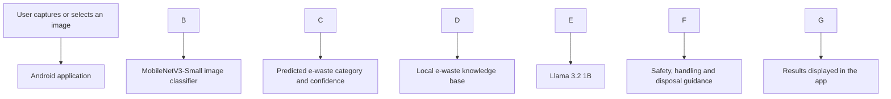

# EcoSort AI

**An AI-powered Android assistant for e-waste identification, safe handling, and responsible disposal.**

EcoSort AI combines image-based classification with conversational guidance to help users identify common electronic-waste items and understand safer handling and disposal practices.

## App preview

### Home screen

!\[EcoSort AI home screen](screenshots/ecosort-home.jpg)

### E-waste identification example

!\[Mobile phone classification result](screenshots/mobile-phone-classification.jpg)

The example shown identifies a **mobile phone** with a displayed classification confidence of **96.71%**. This is one sample result, not a claim of overall model accuracy.

## Key capabilities

* Image-based e-waste classification in the Android app.
* Classification across 12 categories: Battery, Bulb, IC, Keyboard, Laptop, Mouse, Passive Components, PCB, Phone, Resistor, Transistor, and Wires.
* Category-specific information from a local JSON knowledge base.
* Conversational explanations and safety/disposal guidance using Llama 3.2 1B.
* Camera-based image input and a chat-style interface.

## AI components

|Component|Role|
|-|-|
|MobileNetV3-Small (ExecuTorch)|Image-based classification|
|Llama 3.2 1B (ExecuTorch)|Conversational explanations and handling/disposal guidance|
|Local JSON knowledge base|Category-specific hazards and handling information|
|Android application|User interface, image input, inference integration, and chat|

## 

\## System Architecture


The following diagram illustrates the complete EcoSort AI workflow, including image classification, knowledge retrieval and AI-powered disposal guidance.


!\[EcoSort AI System Architecture](documentation/system-architecture.png)

## 

## High-level workflow



## Model performance

The supplied V5 evaluation summary reports:

|Evaluation|Result|
|-|-:|
|Held-out test accuracy|90.70%|
|Macro F1-score|89.92%|
|Real-world accuracy|67.69%|

These are model evaluation results from the supplied V5 evaluation summary. The 96.71% confidence shown in the app screenshot is the confidence for that individual mobile-phone example; it is not the same as dataset accuracy.

## Repository contents

* `app/` — Android application source, resources, model assets, and knowledge-base JSON files.
* `documentation/` — deployment and technical notes.
* `gradle/` — Gradle wrapper configuration.
* `screenshots/` — application screenshots.

## Build the Android application

1. Install Android Studio and the Android SDK required by this project.
2. Clone this repository:

```bash
   git clone https://github.com/sj0785333-stack/EcoSort-AI.git
   ```

3. Open the cloned project root in Android Studio.
4. Allow Gradle sync to complete.
5. Build and run the `app` configuration on a compatible Android device.

## Llama model setup

The Llama model weights are not included in this repository because the model file is approximately 915 MB.

The current application snapshot expects these files in the app-specific external files directory under `llama/`:

* `Llama-3.2-1B-Instruct-8da4w-gptq-2k.pte`
* `tokenizer.json`

The model and tokenizer must be placed in that directory before using the Llama-powered chat feature. The current snapshot does **not** implement automatic first-launch model downloading/provisioning. For evaluator testing, provide the model files through an approved download or offline package and follow `documentation/DEPLOYMENT\_NOTES.md`.

## Deployment notes and limitations

* The MobileNet classifier asset and labels are bundled with the Android app.
* Llama model weights and tokenizer are provisioned separately.
* A clean-device installation test is required before evaluator distribution.
* Reported model performance varies between held-out test data and real-world images; see the metrics above.

## Safety note

EcoSort AI provides informational guidance. It does not replace advice from certified e-waste handlers, qualified technicians, or emergency services. Damaged, swollen, hot, smoking, or leaking batteries should not be handled casually.

## License

No open-source license has been added yet. Unless a license is added, the repository is publicly viewable but reuse and redistribution are not automatically granted.

